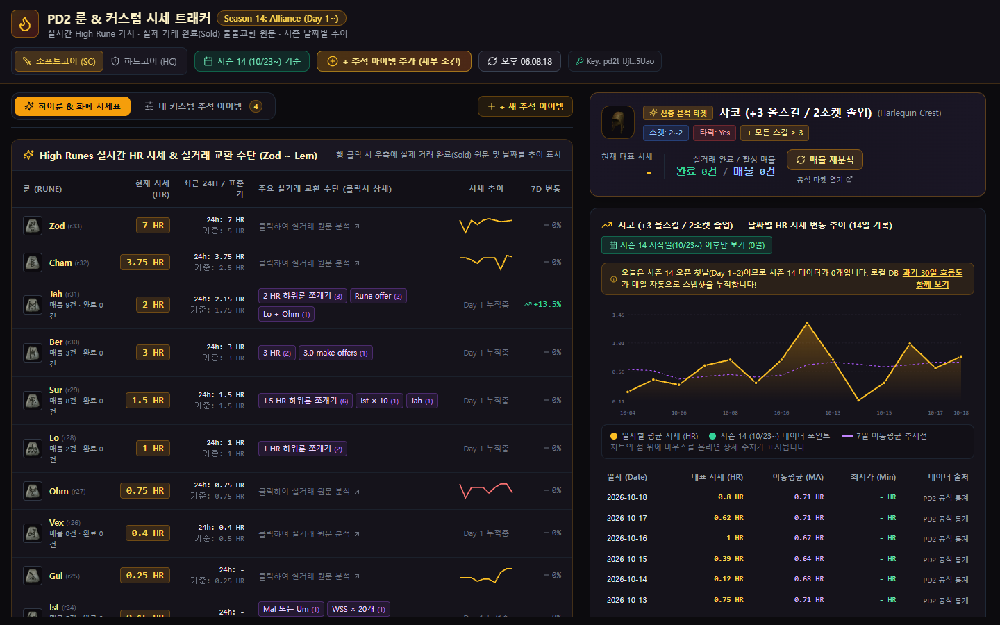
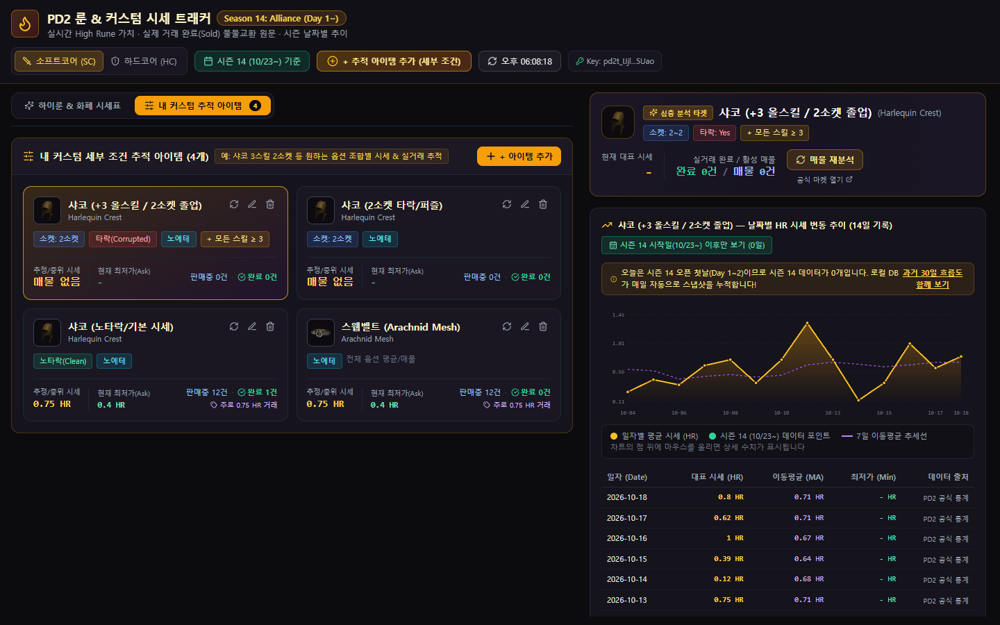

# 🔥 PD2 시세 & 실거래 분석 트래커 (PD2 Market Tracker)

> **"호가(Ask)만 보고 바가지 쓰지 마세요!"**  
> **Project Diablo 2 (Season 14: Alliance)** 실시간 하이룬 시세표, 날짜별 시세 변동 차트, 그리고 **실제 거래 완료(Sold)된 물물교환 원문 텍스트**까지 완벽하게 분석해 주는 데스크탑 거래 도우미입니다.

  
  
  
  

---

## 📸 한눈에 보는 미리보기

### 1. 실시간 하이룬(Zod ~ Lem) 시세표 & 상세 분석
> 룬 시세표가 화면 최상단에 고정되어 언제나 1초 만에 확인 가능하며, 룬을 클릭하면 우측에서 날짜별 시세 차트와 실제 거래 내역을 즉시 볼 수 있습니다.

### 2. 내 커스텀 세부 조건 추적 아이템 보드
> `+` 버튼으로 원하는 아이템의 세부 옵션(예: **샤코 +3 올스킬 / 2소켓**, **스웹벨트**)을 등록하여 조합별 시세와 최저 매물, 실거래 완료가를 한눈에 추적합니다.

---

## ⚡ 왜 이 트래커를 써야 할까요? (핵심 기능)

### 1. 🔍 "실제 얼마에 팔렸는가?" 완료된 거래(Sold) 원문 심층 분석
- 트레이드 사이트에 올라와 있는 비현실적인 희망 호가(Ask)에 속지 마세요.
- **실제 판매 완료(Sold)된 매물의 판매자 원문 텍스트**(`"Sur 2개로 팜"`, `"1.5 HR + Ohm"`, `"300 WSS"`, `"Ohm Vex Gul"`)를 백그라운드 워커가 자연어 분석하여 **진짜 거래 기준가(HR)**를 알려드립니다.

### 2. 🎯 내 맘대로 세부 조건별 시세 추적 (`+` 추적 아이템 등록)
- 같은 샤코라도 **노타락 기본 샤코**, **2소켓 샤코**, **+3 올스킬 2소켓 졸업급 샤코**의 가치는 완전히 다릅니다.
- 소켓 수, 타락 여부(Corrupted/Clean), 에테리얼, 세부 스탯 수치(`올스킬 >= 3` 등)를 지정해 나만의 추적 카드를 만들 수 있습니다.
- 인게임에서 아이템 위에 마우스를 올리고 `Ctrl + C`를 누른 뒤 모달에 붙여넣으면 옵션이 자동으로 세팅됩니다!

### 3. 📈 시즌 14(10/23~) 날짜별 시세 변동 추이 차트
- 하이룬과 주요 고가 아이템의 14일간 날짜별 평균 시세선, 7일 이동평균선(MA), 최고가/최저가를 인터랙티브 SVG 차트로 제공합니다.
- 시즌 14 오픈 이후의 순수 데이터만 필터링하여 실시간 인플레이션을 바로 체감할 수 있습니다.

### 4. 🧮 실시간 룬 쪼개기(Break) & WSS 환산 계산기
- `"지금 Ber 룬을 Sur 2개로 쪼개는 게 이득일까, Jah + Lo로 쪼개는 게 이득일까?"`
- 현재 실시간 시세를 기준으로 큐빙 정석 대비 손익 HR을 1초 만에 계산해 드립니다.

### 5. 🗂️ 독립 탭 분리 레이아웃
- `[하이룬 & 화폐 시세표]`와 `[내 커스텀 추적 아이템]` 탭이 완벽하게 분리되어 있어, 관심 아이템을 10개, 50개 등록해도 룬 시세표의 접근성이 흔들림 없이 100% 보장됩니다.

---

## 🔒 안심하고 사용하세요! (여기는 이상한 곳이 아닙니다 🛡️)

> **"개인정보나 계정 유출 위험은 전혀 없나요?"**  
> **100% 안전합니다.** 본 프로젝트는 투명하게 코드가 공개된 순수 오픈소스 소프트웨어입니다.

- ❌ **계정 비밀번호, 이메일, 개인정보를 절대 요구하지 않습니다.**
- ❌ **별도의 외부 수집 서버가 없습니다.** 데이터는 오직 사용자의 PC에서 공식 `pd2trader.com` API 서버로만 직접 통신합니다.
- 💾 **API Key 및 관심 목록은 본인 컴퓨터의 로컬 저장소(LocalStorage)에만 안전하게 암호화 보관**되며, 어디로도 전송되지 않습니다.
- 📜 소스코드는 본 GitHub 저장소에서 누구나 투명하게 검증하실 수 있습니다.

---

## 🔑 PD2 Trader 무료 API Key 발급 방법 (30초 컷)

PD2 공식 거래소 데이터를 조회하기 위해 공식 API Key가 딱 1번 필요합니다.

1. [pd2trader.com/profile](https://pd2trader.com/profile) 에 로그인하여 접속합니다.
2. 페이지 하단의 **[API Keys]** 메뉴로 이동합니다.
3. **[+ Generate Key]** 버튼을 클릭하여 새 키(`pd2t_...`)를 복사합니다.
4. 앱 실행 시 나타나는 안내 창에 복사한 키를 붙여넣고 **[저장하고 시작하기]**를 누르면 끝!
   - *최초 1회만 입력하시면 본인 PC에 영구 저장되므로 이후에는 다시 입력하실 필요가 없습니다.*

---

## 🚀 다운로드 및 실행 방법

Node.js나 복잡한 개발 도구를 설치할 필요가 전혀 없는 **단일 윈도우 실행 프로그램**입니다.

1. 우측의 **[Releases](https://github.com/dhth1/pd2s/releases)** 탭으로 이동합니다.
2. 최신 버전의 ZIP 압축 파일을 다운로드합니다:
   - 📦 **무설치 포터블 버전**: `pd2-tracker-vX.Y.Z-portable-windows-x64.zip`  
     (압축 풀고 `pd2-tracker.exe`를 바로 더블클릭하면 즉시 실행)
   - 📦 **설치 프로그램 버전**: `pd2-tracker-vX.Y.Z-installer-windows-x64.zip`  
     (바탕화면에 바로가기 아이콘을 만들고 싶으신 분 추천)
3. 압축을 해제하고 즐겁게 파밍 & 트레이딩하시면 됩니다!

> [!TIP]
> **왜 .exe가 아니라 .zip 파일로 제공되나요?**  
> 크롬, 엣지 등 웹 브라우저에서 날것의 `.exe` 파일을 다운로드할 때 발생하는 보안 경고 및 자동 다운로드 차단 현상을 방지하고, 모든 유저가 안심하고 안전하게 받을 수 있도록 ZIP으로 압축하여 배포합니다.

---

## 🛠️ 기술 스택

- **Core & GUI**: [Tauri 1.8](https://tauri.app/) (Rust 기반의 초경량 네이티브 데스크탑 엔진, RAM 점유율 40MB 미만)
- **Frontend**: React 18, TypeScript, Tailwind CSS, Lucide Icons
- **Data Engine**: Web Worker (대용량 물물교환 자연어 정규식 파싱 및 시계열 집계 비동기 분산 처리)
- **Test & CI/CD**: Vitest, Puppeteer (Headless E2E Browser Testing), GitHub Actions 자동 빌드/릴리즈

---

## 📜 라이선스

This project is licensed under the MIT License - see the [LICENSE](LICENSE) file for details.  
Project Diablo 2 및 관련 에셋에 대한 모든 권리는 PD2 팀에 있습니다.
