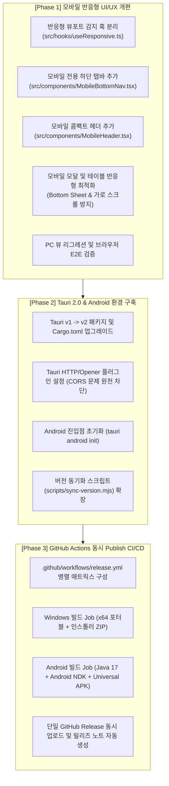

# [구현 계획서] 모바일(Android) 반응형 UI 최적화 & PC·모바일 동시 자동 배포 파이프라인

본 문서는 **Project Diablo 2 시세 & 실거래 트래커**를 모바일(Android) 환경에 맞추어 UI/UX를 전면 최적화하고, 기존 PC(Windows) 버전과 함께 **GitHub Actions를 통해 버전 태그 푸시 시 동시 자동 빌드 및 Publish**되도록 구축하기 위한 종합 통합 계획서입니다.

---

## 1. 개요 및 목표

1. **모바일 반응형 UI/UX 완성**:
   - 스마트폰 세로 모드(360px ~ 430px)에서도 한손으로 룬 시세, 커스텀 관심 아이템, 실거래 원문 분석을 쾌적하게 조회할 수 있도록 모바일 하단 탭 내비게이션(`MobileBottomNav`) 및 콤팩트 카드/모달 레이아웃 구축.
   - 기존 PC 해상도(1440x920 이상)에서는 기존의 2단 독립 스크롤 분할 레이아웃 100% 유지 (리그레션 제로).
   - 500줄 초과 방지를 위해 신규 전용 컴포넌트(`MobileBottomNav.tsx`, `MobileHeader.tsx`, `useResponsive.ts`)로 철저한 관심사 분리.

2. **Tauri 2.0 마이그레이션 & 모바일 지원**:
   - 정식 모바일(Android/iOS)을 1급 시민으로 지원하는 **Tauri 2.0**으로 업그레이드.
   - 모바일 Webview의 CORS 차단을 근본적으로 해결하기 위해 Rust 네이티브 기반 `@tauri-apps/plugin-http` 연동.
   - 외부 브라우저 열기를 `@tauri-apps/plugin-opener` 또는 `@tauri-apps/plugin-shell`로 마이그레이션.

3. **PC(Windows) + 모바일(Android) GitHub Actions 동시 자동 배포 (CI/CD)**:
   - `package.json`의 버전 번호가 올라가면 단일 워크플로우 내에서:
     - **Windows Runner**: Windows 무설치 포터블 `.zip` 및 인스톨러 `.zip` 빌드
     - **Ubuntu Runner**: Android SDK/NDK 세팅 후 Android Universal `.apk` 빌드
     - **Release 단계**: 두 플랫폼의 산출물을 수집하여 하나의 GitHub Release에 동시 업로드!

---

## 2. 세부 구현 단계 (Phase 1 ~ Phase 3)

---

## 3. 세부 작업 명세서

### Phase 1: 모바일 반응형 UI/UX 전면 최적화

- **[신규] `src/hooks/useResponsive.ts`**:
  - 화면 너비(`window.innerWidth < 768px`)를 감지하여 `isMobile` 여부 반환 (리사이즈 디바운스 적용, 메모이제이션으로 리렌더링 최소화).
- **[신규] `src/components/MobileBottomNav.tsx`**:
  - 모바일 화면 하단에 고정되는 탭바:
    - 🪙 **룬 시세** (`RuneMatrixTable` 표시)
    - 📋 **추적 보드** (`CustomWatchlistBoard` 표시)
    - 🔍 **상세 분석** (`ItemDetailPanel` 표시)
    - ⚙️ **설정/API** (API Key 및 SC/HC 토글)
  - 선택한 아이템이 있을 때 상세 분석 탭에 알림 뱃지 표시.
- **[신규] `src/components/MobileHeader.tsx`**:
  - 기존 [HeaderBar.tsx](file:///C:/AntigravityWorkspace/pd2s/src/components/HeaderBar.tsx)가 모바일에서 가로로 넘쳐 깨지지 않도록, 모바일 화면에서는 상단 로고 + 시즌 14 필터 + `+` 간편 추가 버튼만 슬림하게 노출.
- **`src/App.tsx` 리팩토링 (500줄 초과 방지)**:
  - 데스크탑 환경(`!isMobile`): 기존 좌우 2단 분할 레이아웃 유지.
  - 모바일 환경(`isMobile`): 활성화된 하단 탭 1개만 화면 전체에 렌더링.
  - 리팩토링 후 `App.tsx` 줄 수가 450줄에서 약 350줄 수준으로 경량화됨.
- **`src/components/RuneMatrixTable.tsx` & `CustomWatchlistBoard.tsx`**:
  - 작은 화면에서 테이블 컬럼 자동 숨김(스파크라인 숨김 또는 콤팩트 카드형 전환)으로 가로 스크롤 제거.
- **`src/components/AddWatchItemModal.tsx`**:
  - 모바일에서는 화면 아래에서 위로 올라오는 바텀 시트(Full-screen Modal) 형태로 변경하여 스마트폰 가상 키보드가 올라와도 입력창이 가려지지 않도록 패딩 및 스크롤 개선.

---

### Phase 2: Tauri 2.0 마이그레이션 & Android 환경 구성

- **Tauri 2.0 패키지 교체**:
  - `@tauri-apps/api@^2.0.0`, `@tauri-apps/cli@^2.0.0`
  - 플러그인 추가: `@tauri-apps/plugin-http` (CORS 우회), `@tauri-apps/plugin-opener` (외부 브라우저 링크 열기), `@tauri-apps/plugin-shell`
- **Rust 백엔드 (`src-tauri/Cargo.toml` & `src-tauri/src/main.rs`)**:
  - Tauri 2.0 사양으로 의존성 및 플러그인 초기화 코드 업데이트.
- **CORS 우회 HTTP 서비스 연동 (`src/services/marketApi.ts`)**:
  - 데스크탑/모바일 네이티브 환경에서는 `@tauri-apps/plugin-http`의 `fetch`를 우선 사용하고, 웹 브라우저 환경에서는 표준 `window.fetch`로 자동 폴백(Fallback)하도록 래퍼 함수 적용.
  - 이를 통해 **안드로이드 웹뷰의 까다로운 CORS 보안 정책을 100% 무력화**하여 시세 데이터를 안정적으로 수집.
- **버전 동기화 스크립트 확장 (`scripts/sync-version.mjs`)**:
  - Tauri 2.0 설정 포맷에 맞추어 `package.json` 버전 변경 시 안드로이드 `versionCode`와 `versionName`도 함께 자동 계산되도록 업데이트.

---

### Phase 3: GitHub Actions 동시 Publish CI/CD 워크플로우

- **`.github/workflows/release.yml` 구조 개편**:
  1. `check-version`: 버전 변경 여부 확인 및 Git Tag(`vX.Y.Z`) 생성 (공통).
  2. `build-windows` (runs-on: windows-latest):
     - Rust + Node.js 20 캐시 세팅
     - `npx tauri build`
     - 무설치 포터블 `.zip` 및 인스톨러 `.zip` 생성 후 GitHub Actions Artifact로 업로드.
  3. `build-android` (runs-on: ubuntu-latest):
     - Java 17 + Android SDK & NDK 캐시 세팅
     - Rust 타깃 추가 (`aarch64-linux-android`, `x86_64-linux-android`)
     - `npx tauri android build --apk`
     - 범용 `pd2-tracker-vX.Y.Z-android.apk` 생성 후 GitHub Actions Artifact로 업로드.
  4. `publish-release` (needs: [build-windows, build-android]):
     - 양쪽 빌드 산출물을 일괄 다운로드
     - GitHub Release에 Windows ZIP 파일들과 Android APK 파일을 한 번에 첨부하여 발행!

---

## 4. 파일 크기 및 성능/아키텍처 영향 평가

1. **파일 500줄 제한 준수**:
   - 현재 `src/App.tsx` (453줄) ➡️ 모바일 하단 탭 및 레이아웃을 컴포넌트로 분리하여 약 350줄로 감소.
   - 현재 `src/components/AddWatchItemModal.tsx` (482줄) ➡️ 스타일 클래스 정리 및 반응형 분기 깔끔화로 450줄 이내 유지.
   - 신규 파일:
     - `src/hooks/useResponsive.ts` (~35줄)
     - `src/components/MobileBottomNav.tsx` (~90줄)
     - `src/components/MobileHeader.tsx` (~90줄)
2. **성능 & 배터리 최적화**:
   - 모바일 환경에서 백그라운드 Web Worker의 배치 연산 최적화 (`analyzeWatchItemData` 메모이제이션 재사용).
   - 불필요한 리사이즈 이벤트 방지를 위해 `matchMedia` 이벤트 리스너 활용.
3. **기존 PC 버전 안전성**:
   - 미디어 쿼리 기반 분기(`isMobile`)이므로 데스크탑 사용자는 기존과 100% 동일한 화면과 사용성 유지.

---

## 5. 단계별 검증 계획

1. **Phase 1 완료 후**:
   - Puppeteer E2E 브라우저 테스트로 모바일 뷰포트(iPhone 14 / Galaxy S24 해상도) 및 데스크탑 뷰포트(1440x920) 동시 캡처 검증.
   - 모바일 하단 탭 전환, 룬 시세표 가로 오버플로우 없음, 모달 열기/닫기 정상 동작 확인.
2. **Phase 2 완료 후**:
   - `npm run build` 및 TypeScript 컴파일 오류 제로 확인.
   - Tauri v2 로컬 빌드 및 안드로이드 프로젝트 구조 정합성 검증.
3. **Phase 3 완료 후**:
   - `.github/workflows/release.yml` 문법 및 액션 스텝 유효성 검증.
   - `APP_MAP.md`에 신규 모듈 및 아키텍처 변경사항 즉시 업데이트.
