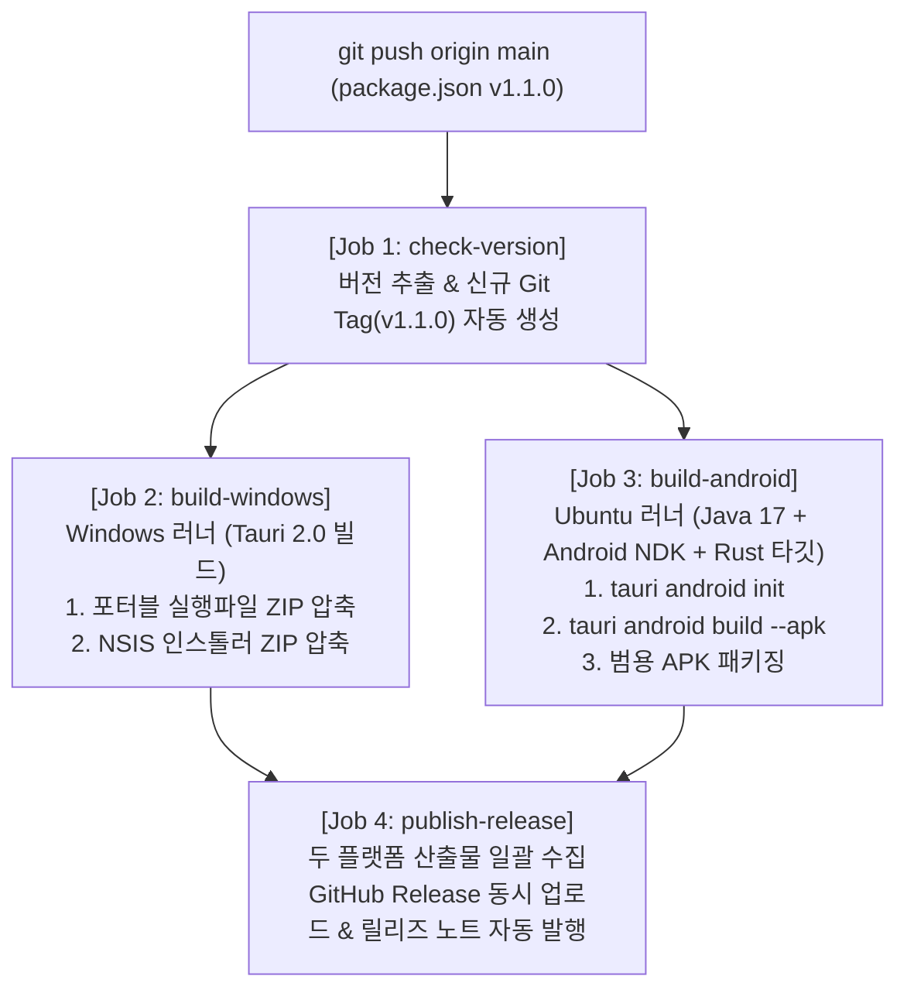

# GitHub 자동 태그 & Windows·Android 동시 자동 배포 CI/CD 파이프라인

## 1. 개요
- **단일 버전 관리 파일 지정**: 루트의 `package.json` 딱 하나만 수정하도록 설정.
- 형님이 `package.json`의 `"version"`을 변경(예: `"1.0.1"` ➡️ `"1.1.0"`)하여 GitHub에 push하면:
  1. GitHub Actions가 이전 태그와 비교하여 버전 변경을 자동 감지
  2. 새로운 git tag(예: `v1.1.0`)를 자동으로 생성 및 푸시
  3. **Windows 러너**와 **Ubuntu 러너**에서 각각 PC 버전과 Android 모바일 버전을 **동시에 병렬 빌드**
  4. Windows 버전은 브라우저 다운로드 경고 방지를 위해 `.exe` 산출물을 **`.zip`으로 자동 압축**
  5. Android 버전은 `aarch64` / 범용 **`.apk` 설치 파일**로 수집
  6. 두 플랫폼의 결과물을 **단일 GitHub Release 페이지에 동시 업로드 및 릴리즈 발행**

---

## 2. 세부 파이프라인 구조



---

## 3. 세부 설계 및 구성 요소

### A. 버전 단일 관리 파일: `package.json`
- 형님은 오직 `package.json`의 `version` 필드만 수정하시면 됩니다:
  ```json
  {
    "name": "pd2-market-tracker",
    "version": "1.1.0",
    ...
  }
  ```

### B. 버전 자동 동기화 스크립트 (`scripts/sync-version.mjs`)
- `package.json`의 버전을 읽어 `src-tauri/tauri.conf.json`과 `src-tauri/Cargo.toml`의 버전을 빌드 전 자동으로 일치시켜 주는 경량 스크립트.

### C. GitHub Actions 워크플로우 (`.github/workflows/release.yml`)
1. **Job 1: `check-version`**:
   - `package.json`의 버전 문자열 추출 (예: `1.1.0`).
   - 원격 저장소에 `v1.1.0` 태그가 이미 존재하는지 체크.
   - 이미 있는 버전이면 빌드를 건너뛰고 종료.
   - 새로운 버전이면 자동으로 `v1.1.0` 태그 생성 및 원격 push.
2. **Job 2: `build-windows` (Windows-latest 러너)**:
   - Rust toolchain 및 Node.js 20 세팅.
   - `npm ci`, `npx tauri build` 수행.
   - 빌드 산출물:
     - 포터블 실행 파일: `pd2-tracker.exe` ➡️ `pd2-tracker-v${VERSION}-portable-windows-x64.zip`
     - 간편 설치 프로그램: `src-tauri/target/release/bundle/nsis/*.exe` ➡️ `pd2-tracker-v${VERSION}-installer-windows-x64.zip`
3. **Job 3: `build-android` (Ubuntu-latest 러너)**:
   - Java 17 + Android SDK & 최신 NDK 세팅.
   - Rust Android 타깃 추가 (`aarch64-linux-android`, `armv7-linux-androideabi`, `i686-linux-android`, `x86_64-linux-android`).
   - `npx tauri android init`, `npx tauri android build --apk` 수행.
   - 산출물: `pd2-tracker-v${VERSION}-*.apk`
4. **Job 4: `publish-release`**:
   - `actions/download-artifact@v4`로 Windows ZIP 파일들과 Android APK 파일들을 한 폴더에 수집.
   - `softprops/action-gh-release@v2` 액션을 사용하여 **단일 Release 페이지에 PC용 ZIP과 모바일용 APK를 한 번에 동시 첨부**하여 배포 완료!
