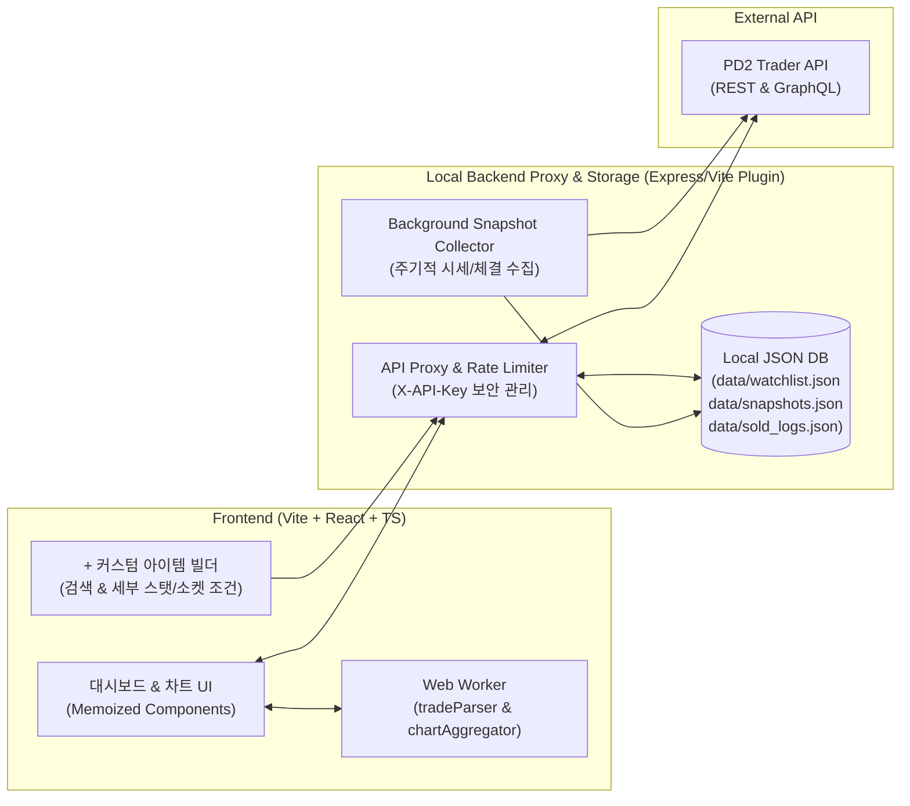

# PD2 시세 & 실거래 추적 대시보드 (PD2 Market Tracker) 구현 계획서

> [!IMPORTANT]
> 본 문서는 **Project Diablo 2 (Season 14: Alliance)** 시작일(2026-10-23 UTC / 한국시간 10-24)부터 하이룬, 주요 화폐, 그리고 사용자가 `+` 버튼으로 직접 세부 조건(예: **샤코 +3 올스킬, 2소켓**)을 지정해 추가한 커스텀 아이템들의 **1) 실시간 HR 시세, 2) 실제 거래 완료 내역 및 물물교환 원문 분석, 3) 시즌 날짜별/시간대별 시세 변동 추이**를 완벽하게 추적하기 위한 설계서입니다.

---

## 1. 실제 API 연동 사전 테스트 (Fact-Check 완료)

형님께서 제공해 주신 API Key(`pd2t_IJjlom7K_...`)로 `pd2trader.com`의 모든 엔드포인트를 사전 호출하여 응답 스키마를 검증했습니다. 만들다가 막히는 일이 없도록 아래의 실제 데이터 특성과 예외 상황까지 모두 아키텍처에 반영했습니다.

### 검증된 백데이터 엔드포인트 및 역할
1. **`GET /api/seasons`**:
   - 현재 시즌 정보 확인 완료 (`id: "s14"`, `label: "Alliance (S14)"`, `startDate: "2026-10-23"`).
2. **`GET /api/items?category=runes|currency|ubers` & `POST /graphql`**:
   - 모든 하이룬(`r20` Lem ~ `r33` Zod) 및 주요 화폐(WSS, 퍼즐박스, 디모닉 큐브 등)의 현재 HR 시세(`lastDayPrice`, `medianPrice`, `movingAverage7Days`), 7일 변동률, 그리고 일자별 `history` 배열(`date`, `avgPrice`, `movingAverage`)을 즉시 반환합니다.
3. **`POST /api/market/search` (`source: "live"` 및 `source: "archive"`)**:
   - **`source: "live"`**: 현재 거래소에 올라온 실시간 매물 리스트와 판매자 희망가(`hr_price` 및 `price` 자유 텍스트 원문) 조회.
   - **`source: "archive"`**: 실제 거래 완료(`accepted_offer_id` 존재 또는 판매 완료 처리)되어 아카이브로 넘어간 매물 조회.
   - **정밀 조건 필터링 검증 완료**:
     - `socketsMin: 2, socketsMax: 2`, `corrupted: "yes"`
     - `stats: [{ kind: "pseudo", key: "pseudo_all_skills", min: 3, enabled: true }]` 또는 `{ kind: "mod", key: "item_allskills", min: 3, enabled: true }`
     - 위 필터를 조합하면 **"샤코 +3 올스킬 2소켓"** 매물만 정확히 타겟팅하여 실시간 매물과 완료된 거래를 모두 가져올 수 있음을 확인했습니다.
4. **`POST /api/price-check` & `GET /item-prices/corruption-prices`**:
   - 특정 아이템의 타락 옵션별/소켓별 시세 분포와 유사 매물(`comparables`) 기반 추정가(`low`, `mid`, `high`)를 제공합니다.
5. **`GET /api/search?q={query}`**:
   - `+ 아이템 추가` 모달에서 아이템 이름이나 별칭(예: `"shako"`, `"griffon"`, `"tyrael"`)을 입력할 때 자동완성 목록과 아이템 아이콘(`iconUrl`), `baseCode`를 즉시 반환합니다.

### ⚠️ 사전 검증에서 발견한 3가지 핵심 주의사항 및 해결 설계 ("아차차" 방지!)
1. **시즌 오픈 첫날(Day 1~3) 데이터 오염 문제**:
   - API의 `movingAverage7Days`나 `30d` 평균가는 시즌 오픈 직후 표본이 적을 때 이전 시즌(S13 말기) 데이터가 섞여서 나올 수 있습니다(예: Ber 룬의 30일 평균이 16.5 HR로 잡히는 현상 확인).
   - **해결책**: 시즌 14 시작 시각(`2026-10-23T00:00:00Z`) 이후에 생성/갱신된 데이터만 필터링하는 **[S14 순수 데이터 필터]**와 실시간 최저가/최근가(`lastDayPrice` + `live` 매물 중위값)를 우선 표시하는 스마트 보정 로직을 탑재합니다.
2. **판매자의 자유 텍스트(`price`) 파싱 문제**:
   - 유저들이 가격란에 숫자로 `hr_price: 3`을 넣기도 하지만, `hr_price: null`로 두고 `price: "1.5 Break"`, `"25wss"`, `"2 sur"`, `"100 pgem"`, `"jah + ohm"`처럼 텍스트로만 적는 경우가 절반 이상입니다.
   - **해결책**: 전용 **Web Worker (`tradeParser.worker.ts`)**를 두어 `price` 원문 텍스트를 자연어/정규식으로 분석합니다. 무엇으로 거래되고 있는지(**[WSS 거래 비중]**, **[하위 룬 쪼개기 비중]**, **[보석/기타 물물교환 비중]**)를 자동 분류하고, 텍스트에 적힌 룬/WSS 수량을 현재 시세로 역산해 추정 HR 가치까지 함께 보여줍니다.
3. **커스텀 세부 조건 아이템(예: 샤코 3스킬 2소켓)의 일자별 시세 추이 생성**:
   - 기본 `history` API는 아이템 기본 코드(`harlequin_crest` 전체) 단위로만 묶이므로, 세부 조건 아이템은 우리 앱이 직접 시계열 데이터를 만들어야 합니다.
   - **해결책**:
     1. 아이템 등록 즉시 `live` + `archive` 매물들의 타임스탬프(`created_at`, `updated_at`)를 일자/시간대별로 집계해 **즉각적인 과거 추이 차트(Backfill)**를 생성합니다.
     2. 로컬 백엔드(`data/market_history.json`)가 주기적으로(및 새로고침 시) 등록된 모든 관심 아이템의 시세 스냅샷과 실제 거래 완료 로그를 **내 PC에 영구 누적 저장**합니다.

---

## 2. 시스템 아키텍처 및 기술 스택



- **프론트엔드**: React 18 + TypeScript + Vite + Tailwind CSS + Lucide Icons + Recharts (또는 경량 Canvas 차트)
- **멀티 워커 & 성능 최적화**:
  - 대량의 매물 리스트와 거래 완료 원문 텍스트 파싱, 날짜별/시간별 시계열 데이터 집계는 모두 **Web Worker (`src/workers/marketAnalysis.worker.ts`)**에서 비동기로 처리하여 UI 프레임 드랍(버벅임)을 원천 차단합니다.
  - `React.memo`, `useMemo`, `useCallback`을 철저히 적용하여 실시간 데이터 갱신 시 변경된 셀만 리렌더링되도록 구현합니다.
- **로컬 서버 & 영구 저장소**:
  - 브라우저 CORS 문제를 완벽히 우회하고, 형님의 컴퓨터 로컬 디스크(`data/` 폴더)에 **1) 커스텀 관심 아이템 목록, 2) 날짜/시간별 시세 스냅샷, 3) 수집된 실거래(Sold) 아카이브 로그**를 JSON 데이터베이스 형태로 자동 저장하는 경량 로컬 API 서버를 통합 구동합니다.

---

## 3. 핵심 화면 및 기능 설계

### ① 상단 컨트롤 바 & 시즌 14 요약 헤더
- **리그 선택 스위치**: `Softcore Ladder (기본값)` / `Hardcore Ladder` / `Non-Ladder` 즉시 전환.
- **시즌 필터 토글**: `시즌 14 (2026-10-23~) 순수 데이터만 보기` vs `전체 기간(최근 30일) 보기`.
- **실시간 동기화 상태**: 마지막 업데이트 시각, 자동 새로고침(예: 5분 간격) 토글, `[지금 전체 스냅샷 찍기]` 버튼, API Key 설정 모달.

### ② 메인 탭 1: 하이룬 & 화폐 종합 시세표 (High Runes & Currency Matrix)
- **대상**: Lem(`r20`) ~ Zod(`r33`) 14종 룬 + 핵심 화폐(WSS, 퍼즐박스, 퍼즐피스, 디모닉 큐브, 카탈리스트 샤드 등).
- **표시 정보**:
  - **현재 기준 HR** (시즌 14 실시간 중위값 / 최근 거래가 / 7일 이동평균 비교 표시)
  - **실시간 매물 최저가(Ask) & 등록 매물 수**
  - **주요 실거래 지불 수단 요약 태그**: 예) `Ber Rune` 옆에 `[Sur×2 (40%)]`, `[300 WSS (30%)]`, `[Jah+Lo (20%)]` 형태로 무엇으로 실제 교환되고 있는지 배지 표시!
  - **미니 스파크라인(추이 그래프)** 및 전일 대비 등락률(`+13.5%` 등).
- **보너스 꿀기능 - [룬 쪼개기/합치기 계산기]**: 특정 하이룬을 클릭하면 우측에 현재 시세 기준으로 하위 룬이나 WSS로 쪼갤 때의 손익을 자동 계산해 표시합니다.

### ③ 메인 탭 2: 내 커스텀 관심 아이템 추적 보드 (`+ 아이템 추가` 기능)
- **`+ 추적 아이템 추가` 모달**:
  1. **아이템 실시간 검색**: `"Shako"`, `"Harlequin Crest"` 등 입력 시 아이콘과 함께 자동완성 선택.
  2. **세부 조건 빌더**:
     - **소켓 조건**: `최소 소켓 (0~6)` ~ `최대 소켓 (0~6)` (예: `2소켓` 고정)
     - **상태 조건**: 타락 여부(`Yes / No / Any`), 에테리얼 여부(`Yes / No / Any`)
     - **핵심 스탯/타락 옵션 필터**: 자주 쓰는 옵션 원클릭 프리셋(`+ 모든 스킬 (All Skills)`, `+ 스킬 탭`, `패캐 (FCR)`, `공속 (IAS)`, `증뎀 (ED%)`, `모든 저항 (All Res)`, `매찬 (MF%)`, `물리 피해 감소 (PDR%)` 등) + 수치 입력(예: `All Skills >= 3`).
     - **클립보드 붙여넣기(`Ctrl+V`) 자동 인식**: 인게임 아이템 텍스트를 붙여넣으면 위 조건들을 자동으로 파싱해 채워주는 편의 기능!
  3. **커스텀 라벨 지정**: 예) `"샤코 (3스킬 / 2소켓 졸업)"`, `"무공 에테 맨캐처"` 등 내가 알아보기 쉬운 이름으로 저장.
- **추적 카드/테이블 뷰**:
  - 하이룬과 동일하게 **현재 추정 HR 시세**, **현재 올라온 매물 최저가**, **실제 완료된 거래 가격**, **등록일/시즌 시작일 이후 시세 변동 그래프**를 한눈에 보여줍니다.

### ④ 상세 분석 드로어/패널: "실제 무엇으로 거래되었는가?" & "날짜별 추이 차트"
- 아무 룬이나 내가 추가한 커스텀 아이템(예: `샤코 3스킬 2소켓`)을 클릭하면 열리는 심층 분석 뷰입니다.
- **섹션 A - 실제 거래 완료(Archive Sold) & 실시간(Live) 거래 내역 분석**:
  - **거래 수단 분포 차트**: 워커가 파싱한 실제 거래 요구 조건 비율 (예: `순수 HR 표기 45%`, `WSS 교환 30%`, `특정 룬 조합(Sur, Jah 등) 15%`, `퍼펙트 보석/기타 10%`).
  - **실거래 & 활성 매물 타임라인 테이블**:
    - 상태 배지 (`[거래완료(Sold)]` 초록색 / `[판매중(Live)]` 파란색)
    - 아이템 상세 옵션 요약 (예: `+3 All Skills, 2 Sockets, Corrupted, 48% MF`)
    - **실제 거래 원문 (`price`)**: 판매자가 적은 날것 그대로의 텍스트 (예: `"2 sur or 3.0"`, `"350 wss"`, `"jah + vex"`)
    - **환산 HR 가치**: `hr_price` 또는 텍스트 파서가 환산한 HR 값
    - 거래/등록 시각 (한국 시간 KST 변환 표시) 및 판매자 계정명
- **섹션 B - 시즌 14 날짜별 / 시간별 시세 변동 차트 (Time-Series Chart)**:
  - **API 공식 일별 히스토리(`history`)** + **매물 분포 기반 역산 히스토리** + **내 로컬 DB 누적 스냅샷**을 결합한 인터랙티브 라인/영역 차트.
  - 시즌 14 오픈일(10월 24일)부터 날짜별(초반에는 시간대별 전환 가능) 평균가, 최저가, 중위가의 흐름을 꺾은선 그래프로 선명하게 비교합니다.
  - 여러 룬/아이템을 동시에 체크해서 한 차트 위에서 시세 변동을 겹쳐 비교(Multi-Item Compare)할 수도 있습니다.

---

## 4. 모듈형 디렉토리 및 파일 구조 (500줄 제한 엄수)

각 파일이 단일 책임(Single Responsibility)만 가지도록 잘게 쪼개어, **모든 파일이 250~350줄을 넘지 않도록(최대 500줄 미만 절대 준수)** 설계했습니다.

```text
C:/AntigravityWorkspace/pd2s/
├── APP_MAP.md                                 # 전체 아키텍처, 파일 및 인터페이스 맵 문서
├── package.json                               # 프로젝트 의존성 및 실행 스크립트
├── vite.config.ts                             # Vite 설정 및 로컬 백엔드 API 미들웨어 연결
├── tsconfig.json                              # TypeScript 설정
├── docs/
│   └── implementation_plan.md                 # 본 구현 계획서 사본 보관
├── data/                                      # 로컬 영구 데이터 저장소 (자동 생성/갱신)
│   ├── watchlist.json                         # 기본 하이룬 + 사용자 추가 커스텀 아이템 설정
│   ├── snapshots.json                         # 날짜/시간별 시세 누적 스냅샷 DB
│   └── sold_history.json                      # 수집된 실제 거래 완료(Sold) 내역 영구 보관
├── server/
│   ├── apiMiddleware.ts                       # 로컬 백엔드 라우터 (/api/pd2/* 및 로컬 DB CRUD)
│   ├── pd2Client.ts                           # PD2 Trader REST & GraphQL 호출 클라이언트
│   └── storageService.ts                      # 로컬 JSON DB 읽기/쓰기/스냅샷 병합 모듈
└── src/
    ├── main.tsx                               # 엔트리 포인트
    ├── App.tsx                                # 전체 레이아웃 및 상태 오케스트레이션
    ├── types/
    │   └── market.types.ts                    # 룬, 커스텀 아이템 필터, 매물, 시계열 타입 정의
    ├── constants/
    │   ├── defaultWatchlist.ts                # 하이룬(Lem~Zod), 화폐 기본 목록 및 프리셋
    │   └── statPresets.ts                     # 세부 조건용 주요 스탯 키(All Skills, FCR 등) 사전
    ├── workers/
    │   ├── marketAnalysis.worker.ts           # 거래 원문(price) 파싱, 물물교환 분류, 시계열 집계 워커
    │   └── useMarketWorker.ts                 # 워커 통신 및 메모이제이션 커스텀 훅
    ├── services/
    │   └── marketApi.ts                       # 프론트엔드 <-> 로컬 서버 API 통신 모듈
    └── components/
        ├── HeaderBar.tsx                      # 시즌 14 상태, SC/HC 스위치, 동기화 & API 키 설정
        ├── RuneMatrixTable.tsx                # 하이룬 & 주요 화폐 시세 및 거래수단 요약 테이블
        ├── CustomWatchlistBoard.tsx           # 사용자 추가 커스텀 아이템(샤코 3/2 등) 추적 보드
        ├── AddWatchItemModal.tsx              # '+' 버튼 커스텀 아이템 검색 & 세부 조건(스탯/소켓) 빌더
        ├── ItemDetailPanel.tsx                # 선택한 룬/아이템의 심층 분석 컨테이너
        ├── TradeBreakdownView.tsx             # 실제 거래 완료(Sold) & 판매중 원문 분석 및 물물교환 통계
        ├── PriceTrendChart.tsx                # 시즌 날짜별/시간대별 시세 변동 인터랙티브 차트
        └── RuneBreakCalculator.tsx            # 하이룬 쪼개기/합치기 실시간 손익 계산기 위젯
```

---

## 5. 단계별 구현 및 검증 계획

1. **Step 1: 프로젝트 초기화 및 로컬 백엔드/DB 구축**
   - Vite + React + TypeScript + Tailwind 환경 세팅.
   - `server/pd2Client.ts` 및 `server/storageService.ts` 구현 (형님의 API Key 기본 내장 + 로컬 `data/` 폴더 자동 생성 및 스냅샷 저장).
2. **Step 2: Web Worker 기반 데이터 파서 & 시계열 집계 엔진 구현**
   - `"2 sur"`, `"25wss"`, `"100 pgem"`, `"1.5 break"` 등 실제 거래 원문을 분석해 거래 수단 통계를 내는 토크나이저 워커 작성.
   - 시즌 14 시작일(2026-10-23 UTC / 10-24 KST) 기준 날짜별/시간별 추이 데이터 생성 로직 구현.
3. **Step 3: 하이룬 시세표 & `+` 커스텀 아이템 조건 빌더 UI 구현**
   - 하이룬/화폐 종합 시세표, 룬 쪼개기 계산기 구현.
   - `+ 아이템 추가` 모달 구현 (기본 프리셋으로 형님이 말씀하신 **"샤코 (Harlequin Crest) - +3 올스킬 / 2소켓"**을 기본 커스텀 추적 아이템 1호로 미리 등록해 두어 켜자마자 바로 확인하실 수 있게 세팅!).
4. **Step 4: 실거래 완료 내역 뷰 & 날짜별 추이 차트 연동**
   - 완료된 거래(`archive`) 및 실시간 매물(`live`)의 원문 표기, 환산 HR, 날짜별 시세 추이 차트 구현.
5. **Step 5: 성능 점검, 테스트 결과 문서화(`docs/test_results.txt`) 및 `APP_MAP.md` 업데이트**
   - 모든 파일 500줄 미만 여부 체크, 메모이제이션 및 워커 동작 검증, 실제 API 데이터 로딩 테스트 후 결과를 `docs/test_results.txt`와 `APP_MAP.md`에 기록.
